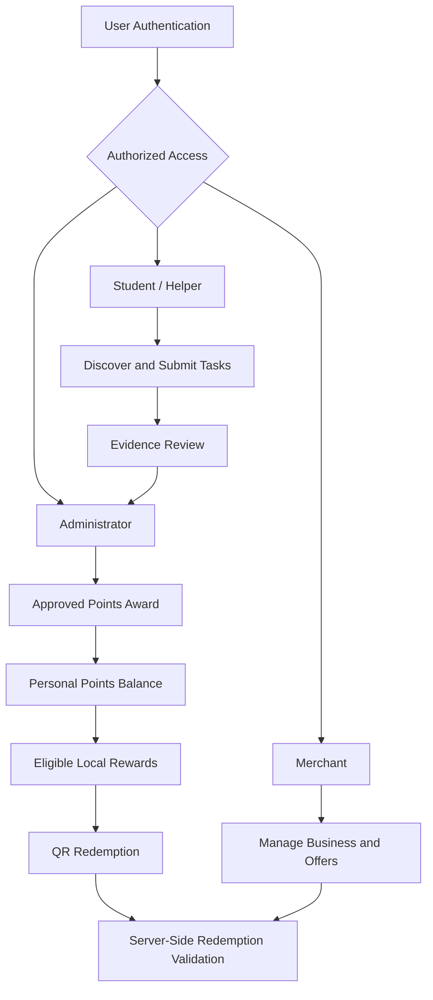

# CivicTask & Local Rewards 🌱

### Small actions. Real impact.

**CivicTask & Local Rewards** is a civic-tech platform designed to encourage community service by connecting students and community helpers with meaningful local tasks and rewards from participating businesses.

Users can contribute to their communities, submit evidence of completed tasks, earn points after verification, and redeem eligible rewards at participating local shops. Local merchants can manage their businesses and offers, while administrators oversee task verification, merchant approval, and platform activity.

**Developed independently by Alisha Batool.**

> Project status: In Development

---

## 📌 Table of Contents

- [The Problem](#-the-problem)
- [The Solution](#-the-solution)
- [Key Features](#-key-features)
- [How It Works](#-how-it-works)
- [User Roles](#-user-roles)
- [Technology Stack](#-technology-stack)
- [Architecture](#-architecture)
- [AI Methodology and API Usage](#-ai-methodology-and-api-usage)
- [Security and Privacy](#-security-and-privacy)
- [Screenshots](#-screenshots)
- [Getting Started](#-getting-started)
- [Environment Configuration](#-environment-configuration)
- [Testing](#-testing)
- [Future Roadmap](#-future-roadmap)
- [Developer](#-developer)
- [License](#-license)

---

## 🎯 The Problem

Community service can make a meaningful difference, but participation is not always easy to sustain. Students and young people may lack a centralized way to discover volunteering opportunities, track their contributions, and receive recognition for their efforts.

At the same time, local businesses often need accessible ways to engage with their communities and support positive social initiatives.

CivicTask & Local Rewards aims to connect these needs through a platform where community contributions can be verified and rewarded.

## 💡 The Solution

CivicTask brings community tasks, verified contributions, reward points, and local business offers into one platform.

It is designed around three principles:

- **Contribution:** Make community-service opportunities easier to discover and complete.
- **Verification:** Award points only after submitted task evidence has been reviewed and approved.
- **Community rewards:** Enable participating businesses to offer incentives that encourage continued engagement.

The platform supports community helpers and merchants within a shared ecosystem. A person who operates a participating shop can also contribute to community tasks and use their personal earned points at other eligible shops.

## ✨ Key Features

### Community participation

- Discover community-service opportunities.
- Explore task instructions, requirements, and point values.
- Submit evidence for completed tasks.
- Track pending, approved, and rejected submissions.
- View earned points and reward history.

### Local business rewards

- Browse participating businesses and eligible offers.
- Discover discounts and reward opportunities.
- Use QR-based redemption where implemented.
- Review previous reward redemptions.

### Merchant management

- Manage an authorized business profile.
- Create and manage eligible offers.
- Validate reward redemptions.
- Review business redemption history.

### Administration and moderation

- Create and manage community tasks.
- Review submitted task evidence.
- Approve or reject submissions.
- Manage merchant applications.
- Monitor reward activity and platform records.

*Feature availability depends on the current implementation. Features that are planned or not yet verified should not be considered production-ready.*

## 🔄 How It Works

1. **Discover:** Users browse available community-service tasks.
2. **Contribute:** Users complete an eligible task.
3. **Submit:** Users provide the required evidence.
4. **Verify:** An authorized administrator reviews the submission.
5. **Earn:** Points are awarded after successful approval.
6. **Redeem:** Users spend eligible points on participating business offers.
7. **Impact:** Community participation supports local engagement and positive social action.

## 👥 User Roles

### Student / Community Helper

Community helpers can discover opportunities, submit task evidence, track approvals, earn points, and redeem eligible rewards.

### Merchant

Merchants can manage their authorized business and offers after approval. An approved merchant can also participate as a community helper using the same account, earn personal points, and redeem those points at other participating shops.

### Administrator

Administrators oversee tasks, submissions, merchant applications, and platform activity. Administrative permissions must be granted through a trusted process rather than public registration.

Role-specific interfaces should be protected by authorization checks and database security rules, not merely by hiding navigation links.

## 🛠 Technology Stack

The project uses Google AI Studio Build mode for AI-assisted development and Firebase for application infrastructure.

| Technology | Purpose |
|---|---|
| Google AI Studio | AI-assisted application development |
| Firebase Authentication | User authentication, where configured |
| Cloud Firestore | Application data storage, where configured |
| Frontend framework | See the project source and package configuration |
| Styling and UI libraries | See the project dependencies |
| QR-code tools | Reward redemption, if implemented |

The exact frontend framework, supporting libraries, and server-side components should be confirmed from the current repository before this README is treated as a definitive dependency inventory.

## 🏗 Architecture

The intended application workflow is:



This diagram describes the intended workflow. The actual implementation may differ depending on which backend operations and authorization controls have been completed.

## 🤖 AI Methodology and API Usage

Google AI Studio was used as an AI-assisted development environment to help build the application.

**AI-assisted development is not the same as AI-powered runtime functionality.** The use of Google AI Studio during development does not by itself mean that CivicTask uses a generative AI model when users interact with the application.

The core workflow can operate through conventional application logic, authentication, database operations, verification rules, and reward validation.

No specific runtime AI model or inference API is claimed in this README. If a model or AI API is integrated into the application, its provider, model identifier, purpose, and configuration should be documented here after confirming the implementation in the source code.

## 🔐 Security and Privacy

Security is important because the platform manages user accounts, task submissions, points, business offers, and reward redemptions.

The intended safeguards include:

- Authentication for protected user functionality.
- Role-specific authorization for Student, Merchant, and Admin operations.
- Trusted provisioning of administrator permissions.
- Firestore Security Rules that restrict access to authorized data.
- Server-side validation of privileged operations.
- Controlled points awards following task approval.
- Validation of reward eligibility and redemption requests.
- Protection against duplicate points awards and repeated QR redemption.
- Secure management of API keys and environment variables.

**Security status:** These controls must be verified against the actual application and deployed Firebase configuration. Their inclusion in this document is not a claim that every safeguard has already been implemented or independently tested.

Never commit private API credentials, service-account keys, or secret environment files to the repository. Firebase web configuration values are not equivalent to server-side secrets; database authorization must be enforced separately.

## 🖼 Screenshots

Screenshots help reviewers understand the application without running it.

Add actual screenshots to a `screenshots/` directory and use the following section to display them. Replace these placeholders after uploading the images.

| Screenshot | What it demonstrates |
|---|---|
| `screenshots/landing-page.png` | Public landing page and navigation |
| `screenshots/student-dashboard.png` | Community participation and points |
| `screenshots/task-submission.png` | Task completion and evidence submission |
| `screenshots/merchant-dashboard.png` | Business management and offers |
| `screenshots/admin-dashboard.png` | Administrative moderation |

Once the images exist, embed them using Markdown, for example:

```markdown

```

Only include screenshots of features that actually exist in the application. Do not include real users' private information, access tokens, or credentials.

## 🚀 Getting Started

These instructions are a general starting point. Confirm the exact commands and configuration against the current repository before running the application.

### Prerequisites

- Git
- Node.js and npm, if the project uses a Node.js frontend
- Access to the Firebase project, if required for local development
- Appropriate environment variables and Firebase configuration

### 1. Clone the repository

```bash
git clone https://github.com/Alisha-Batool/civictask-local-rewards.git
cd civictask-local-rewards
```

Replace the repository URL if your GitHub repository uses a different owner or name.

### 2. Install dependencies

For an npm-based application:

```bash
npm install
```

### 3. Configure the environment

Create a local environment file based on the project's requirements. See [Environment Configuration](#-environment-configuration).

### 4. Configure Firebase

If Firebase is required, configure the appropriate project services:

- Firebase Authentication providers
- Cloud Firestore database
- Firestore Security Rules
- Required indexes
- Authorized domains

Only enable the services used by the application. Do not expose server-side credentials in browser code.

### 5. Run the application

For an npm project with a configured development script:

```bash
npm run dev
```

Open the local URL printed in the terminal.

### 6. Build and test

Use the scripts available in the repository's `package.json`. For projects that define these scripts, typical commands include:

```bash
npm run build
npm run test
```

A command may not be available if its script has not been configured.

## ⚙️ Environment Configuration

Create a local environment file containing only the variables required by the actual source code.

For example, a Vite-based application may use:

```env
VITE_FIREBASE_API_KEY=your_firebase_web_api_key
VITE_FIREBASE_AUTH_DOMAIN=your_project.firebaseapp.com
VITE_FIREBASE_PROJECT_ID=your_project_id
VITE_FIREBASE_STORAGE_BUCKET=your_storage_bucket
VITE_FIREBASE_MESSAGING_SENDER_ID=your_sender_id
VITE_FIREBASE_APP_ID=your_app_id
```

This is an illustrative template, not a verified list of the project's current environment variable names. Use the names expected by the source code and do not add unused variables.

Important:

- Browser-exposed variables such as `VITE_*` are visible to users.
- Never place service-account private keys or server-only secrets in frontend environment variables.
- Keep local secret files out of Git.
- Restrict API keys appropriately and configure Firebase Security Rules.

## 🧪 Testing

The following scenarios should be tested before a public demonstration:

- Registration and login.
- Student/helper task submission.
- Administrative approval and point awards.
- Merchant onboarding and offer management.
- Reward redemption and duplicate-redemption prevention.
- Role-specific navigation and route protection.
- Unauthorized access attempts.
- Mobile responsiveness.
- Build and runtime errors.

Only report tests as passed after actually running them. Add test results here as implementation and verification progress.

## 🗺 Future Roadmap

Potential improvements include:

- More community tasks and participating local businesses.
- Improved mobile accessibility.
- Better reporting of community contributions and local engagement.
- Expanded moderation and audit capabilities.
- Stronger automated security and integration testing.
- Additional languages and localization.
- Optional AI-assisted task recommendations or evidence-support features, if appropriate and implemented responsibly.

These are potential future improvements, not claims of current functionality.

## 👩‍💻 Developer

**Alisha Batool — Solo Developer**

CivicTask & Local Rewards is being developed independently as a civic-tech project exploring how verified community participation can connect students, local businesses, and meaningful rewards.

The project combines application development, authentication, data management, role-based workflows, and community-focused product design.

GitHub: [Alisha-Batool](https://github.com/Alisha-Batool)

## 📄 License

No license has been specified in this README. Unless a license file is added, other users should not assume that they have permission to reuse, modify, or redistribute the project's code.

---

**CivicTask & Local Rewards — Small actions. Real impact.**
